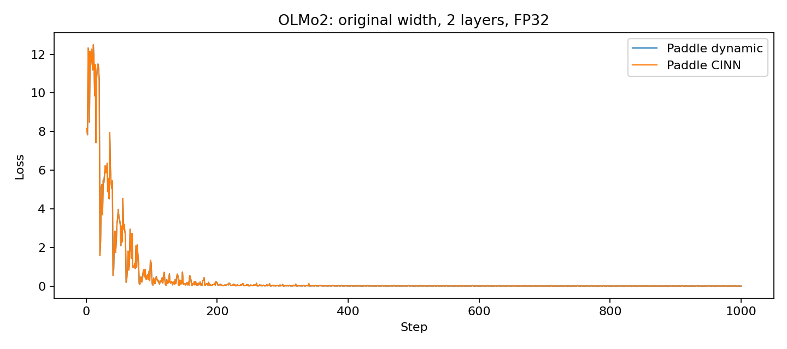

# OLMo2 CINN: original-width, depth-only FP32 test

This entry imports model code from this checkout. It compares **Paddle dynamic**
with **paddle.jit.to_static + CINN**, not Transformers.

## Frozen configuration

- OLMo-2-0425-1B configuration, **16 → 2 layers only**; hidden 2048, FFN 8192,
  Q/KV heads 16/16, vocabulary 100352, 545,277,952 parameters.
- Shared **random initial** FP32 checkpoint, seed 20261116; not pretrained weights.
  This is a framework test, not a production-model quality/speed claim.
- V100S 32GB, batch 1, sequence 128, eager attention, TF32 off; no AMP or distributed training.
- AdamW: lr=2e-5, weight_decay=0.01; all parameters trainable.
- Full forward wrapper compiled through AST. Loss and optimizer remain outside;
  backward is generated through the compiled forward. No manually selected layers
  or operator blacklist. Tensor input/output are explicit; config.get stays Python-only.
- Model code includes the tested RMSNorm row-layout reshape. This adaptation keeps
  tokenwise FP32 normalization/cast order and restores the original shape. It requires
  the accompanying model patch; a clean upstream checkout without the patch is NOT equivalent.

The old hidden-64 tiny checkpoint, old 30,000-step curve and old performance
percentages do **not** reproduce this entry.

## Environment

Python 3.10.20; Paddle GPU 3.5.0.dev20260722, commit
08de6be508389d5277b02e78fbc8742f1ed78160; CUDA runtime 12.6, cuDNN 9.5.1.
Reference driver 580.105.08 (driver-reported CUDA 13.0 is not the runtime version).

Additional installed versions: paddlefleet 0.4.0.post20260808+054c7a9b0a8,
paddlefleet-ops 0.3.0.dev20260604+5ef7e52a, transformers 5.3.0,
tokenizers 0.22.2, numpy 1.26.4, safetensors 0.8.0, matplotlib 3.10.9.
Install this checkout's requirements and the matching Paddle build. These are
tested versions, not a claim that an arbitrary latest wheel will behave identically.
The installed paddlefleet-ops requires a visible CUDA device during import.

## Assets and checkpoint

Download the pinned assets below, or use the matching delivery bundle:

- checkpoint/initial.pdparams (2,181,114,513 bytes): **the only required weight file**.
  Both training and independent inference load this same file.
- assets/: config.json, original_config.json and tokenizer files.
- asset_manifest.json pins exact sizes and SHA256. Missing/mismatched files fail;
  the runner never silently regenerates weights.
- data/gsm8k_24.jsonl is included in this test directory. Source:
  [GSM8K](https://github.com/openai/grade-school-math), MIT.
  The first 20 examples are used cyclically; remaining 4 are not used in this run.
  Tokenize question + newline + answer, truncate to 129 tokens, shift one token
  for 128-token prefix-language-model labels, ignore padded labels. This is not answer-only SFT.

The initial checkpoint is publicly available in the existing
[AI Studio model library](https://aistudio.baidu.com/modelsdetail/53383/space).
It was anonymously streamed in full (2,181,114,513 bytes) and SHA256-verified on
2026-11-27. `checkpoint_source.json` pins the immutable repository revision,
path, size and hash; the downloader does not require an AI Studio token or SDK.
Do **not** use the historical `cinn/olmo2/checkpoint/` tiny/final weight files.

From this checkout, prepare a new asset directory and download the initial checkpoint:

```bash
export PYTHON_BIN=/path/to/python
export CHECKPOINT_DIR=/path/to/olmo2/checkpoint
export CINN_ASSET_DIR=/path/to/new/olmo2/assets
"$PYTHON_BIN" tests/cinn/olmo2/download_assets.py --output "$CINN_ASSET_DIR" --no-proxy
"$PYTHON_BIN" tests/cinn/olmo2/download_checkpoint.py --output "$CHECKPOINT_DIR/initial.pdparams" --no-proxy
"$PYTHON_BIN" tests/cinn/olmo2/verify_assets.py "$CHECKPOINT_DIR"
```

Both downloaders use only Python's standard library. Remove `--no-proxy` if your
network requires a proxy. Existing checkpoint files are verified, never overwritten.
The resource downloader reuses the public tokenizer archive, verifies its size/SHA256,
retains the original 16-layer configuration and creates the exact 2-layer configuration;
all final files must match `asset_manifest.json`. It copies only explicitly named regular
archive members, not arbitrary paths. Dataset and license notices are retained.
The original archive config is **not** the final experimental config; use the prepared assets.

Maintainers can recreate the candidate using prepare_assets.py with the original
config/tokenizer directory; export fails if the parameter hash differs from the
measured initialization. Third-party acceptance should load the delivered checkpoint.

## Run from the repository root

Use a checkout containing this entry and its RMSNorm patch.

```bash
export PYTHON_BIN=/path/to/python
export CHECKPOINT_DIR=/path/to/olmo2-bundle/checkpoint
export CINN_ASSET_DIR=/path/to/olmo2-bundle/assets
export RESULTS_DIR=/path/to/new/olmo2-smoke
bash tests/cinn/olmo2/run_model.sh
bash tests/cinn/olmo2/run_model_cinn.sh
"$PYTHON_BIN" tests/cinn/olmo2/compare_results.py "$RESULTS_DIR"

# Final training and inference, sequentially, from the SAME initial checkpoint:
export RESULTS_DIR=/path/to/new/olmo2-convergence
STEPS=1000 bash tests/cinn/olmo2/run_model.sh
STEPS=1000 bash tests/cinn/olmo2/run_model_cinn.sh
"$PYTHON_BIN" tests/cinn/olmo2/compare_results.py "$RESULTS_DIR" --convergence

# Reproduce the reference protocol: 3 serial independent repeats, both tasks;
# r1 trains 1000 steps per mode; r2/r3 train 150 steps; every inference run is 150 calls.
"$PYTHON_BIN" tests/cinn/olmo2/run_suite.py --output /path/to/new/olmo2-three-repeats
```

GPU_ID defaults to 0. Each shell entry trains and then launches a separate inference
process. train.sh/infer.sh select one task; MODE selects dynamic/cinn.
Outputs must be new directories and are never overwritten. No final trained weights
or optimizer snapshots are saved: only the shared initial checkpoint is needed to
reproduce these fixed-initialization experiments.

Smoke defaults: 20 training steps and 150 inference calls. Performance excludes
the first 50 steps, including compilation/gradient audit; 20-step training is
numerical-only and has no reported steady-state timing.
Inference is fixed 128-token forward, **not cache decode or text generation**.
Time is CUDA-synchronized forward/loss/backward/AdamW for training and forward-only
for inference; excludes input loading. Independent repeats use new RESULTS_DIRs.

## Evidence and acceptance

Every run records framework/source hashes, checkpoint/input hashes, full per-step
loss/timing, initial logits, first-step gradient presence/finiteness and sampled
gradient values. Loss, final parameters and optimizer state must stay finite.
The shell verifies actual CINN compilation logs; flags alone are insufficient.

acceptance.json fixes internal test criteria **before** long training:
initial logits max absolute difference <=1e-4; first 20 losses <=1e-4; sampled
gradients <=1e-4. Long-run acceptance requires at least 1000 steps on both sides,
last-100 mean loss <=0.02, >=99% reduction from the first-100 mean, and last-100
loss MAE <=max(0.001, 5% of the dynamic last-100 mean).
These are framework/subset-fit criteria, **not universal official thresholds or
evidence of held-out task generalization**. A failure requires investigation,
not relaxing thresholds after inspecting results.

compare_results.py writes comparison.json and the unscaled loss_raw.png.
Final performance should use 3 serial independent repeats, the same step 50–149
window, and the mean of each repeat's median. Throughput improvement:
(dynamic_ms / cinn_ms - 1) × 100%; batch-1 training FPS = 1000 / step_ms.
No speedup guarantee is made for other GPUs, shapes, or full-depth models.

## Reference results (2026-11-26)

| Inference dynamic ms | Inference CINN ms | Throughput gain | Training dynamic samples/s | Training CINN samples/s | Throughput gain |
|---:|---:|---:|---:|---:|---:|
| 8.839 | 7.864 | +12.40% | 23.131 | 24.634 | +6.50% |

Training: 43.232 / 40.594 ms per step. These are means of three independent process
medians over steps 50–149; startup and compilation are excluded, not end-to-end runtime.
Both modes completed 1000 steps: last-100 loss 0.0043608625 / 0.0043608452,
tail MAE 4.85e-8; step 400–499 means 0.0086279724 / 0.0086278500 (zero-based).
Initial logits max absolute difference 1.86e-5; sampled first-step gradients 5.12e-8.



Reference code was `565ad12feb6f5715ba7824b7cad5e9e03423ac9e` plus the delivered
OLMo2 RMSNorm/test-entry changes. These numbers belong to that frozen experiment,
not an automatic claim about every later source revision or a fresh software installation.
The initial checkpoint, model math and acceptance criteria are retained in this update.

CPU entry/helper tests are collected through `tests/cinn` in `pyproject.toml`;
they do not download model weights or start the GPU benchmark automatically:

```bash
python -m pytest tests/cinn/olmo2 tests/cinn/test_checkpoint_utils.py
python -m pytest tests/transformers/olmo2/test_rms_norm.py tests/transformers/olmo2/test_tied_checkpoint.py
```
